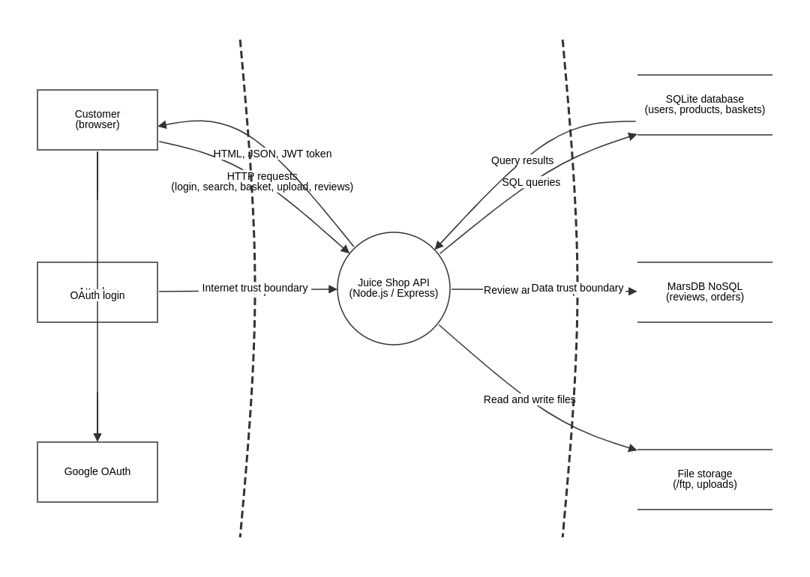

# Threat model: OWASP Juice Shop

Method: STRIDE applied to each element of the data flow diagram, using OWASP Threat Dragon. The model is versioned with the code (`juice-shop-threat-model.json`) and updated when the architecture changes.

## Scope

- Actors: Customer (browser), Attacker, Google OAuth
- Process: Juice Shop API (Node.js / Express, in a Docker container)
- Stores: SQLite database, MarsDB NoSQL store, file storage (/ftp, uploads)
- Trust boundaries: internet to API, API to data stores

## Threats (26)

| # | Element | STRIDE | Severity | Threat | Mitigation | Detected by |
|---|---|---|---|---|---|---|
| 1 | Customer (browser) | Spoofing | Medium | Weak passwords and no MFA by default | Enforce a password policy, check passwords against breached lists, encourage or require 2FA. | DAST (OWASP ZAP) + code review |
| 2 | Customer (browser) | Repudiation | Low | Customer can deny placing an order | Log order and payment events with user id, timestamp and request id to an append only log. | Code review |
| 3 | Google OAuth | Spoofing | High | OAuth accounts get a predictable password | Do not create a local password for OAuth users, or generate a random one; validate the ID token server side. | SAST (Semgrep / CodeQL) + code review |
| 4 | Juice Shop API (Node.js / Express) | Spoofing | High | JWT forgery with a hardcoded signing key | Move the key to a secret manager or environment secret, rotate it, and verify the algorithm on every token (reject 'none'). | Secrets scan (Gitleaks, pre-commit) + SAST |
| 5 | Juice Shop API (Node.js / Express) | Elevation of privilege | High | IDOR on basket API | Check ownership server side: the basket id must match the id in the user's token. | Security unit tests |
| 6 | Juice Shop API (Node.js / Express) | Elevation of privilege | High | Mass assignment on registration | Whitelist accepted fields on registration and always set the role server side. | Security unit tests + SAST |
| 7 | Juice Shop API (Node.js / Express) | Repudiation | Medium | No audit log of sensitive actions | Structured security logging of authentication, authorization failures and admin actions, shipped to a central log store. | Code review |
| 8 | Juice Shop API (Node.js / Express) | Tampering | High | Vulnerable third party npm packages | Keep dependencies updated, pin versions with the lockfile, generate an SBOM, block builds with CRITICAL CVEs. | SCA (Trivy fs, npm audit, Dependabot) + SBOM (Syft) |
| 9 | Juice Shop API (Node.js / Express) | Elevation of privilege | Medium | Container image with excess privileges or vulnerable OS packages | Run as a non-root USER, use a minimal base image, scan the image on every build, sign it. | Dockerfile scan (Hadolint, Checkov) + image scan (Trivy) + signing (Cosign) |
| 10 | SQLite database (users, products, baskets) | Information disclosure | High | Passwords stored as unsalted MD5 | Hash passwords with bcrypt or Argon2 with a per user salt. | SAST (Semgrep / CodeQL) |
| 11 | SQLite database (users, products, baskets) | Information disclosure | Low | Database file not encrypted at rest | Encrypt the volume or move to a managed database with encryption at rest and least privilege accounts. | IaC / config review (Checkov) |
| 12 | MarsDB NoSQL (reviews, orders) | Tampering | High | NoSQL injection modifies other users' reviews | Validate types (id must be a string), never pass raw request objects to queries, update by exact id only. | SAST (Semgrep / CodeQL) |
| 13 | MarsDB NoSQL (reviews, orders) | Denial of service | Medium | NoSQL $where injection blocks the server | Remove $where queries, validate input, set query timeouts. | SAST (Semgrep / CodeQL) + DAST |
| 14 | MarsDB NoSQL (reviews, orders) | Spoofing | Medium | Review posted under another user's name | Take the author from the authenticated token, ignore it in the body. | Security unit tests |
| 15 | File storage (/ftp, uploads) | Information disclosure | High | /ftp folder exposes confidential files | Remove sensitive files, disable directory listing, require authentication for internal documents. | DAST (OWASP ZAP) |
| 16 | File storage (/ftp, uploads) | Information disclosure | Medium | File type filter bypass with a poison null byte | Normalize and decode the path before checking it, use an allow list of exact file names. | DAST (OWASP ZAP) + SAST |
| 17 | File storage (/ftp, uploads) | Tampering | Medium | Unrestricted file upload | Validate type, size and content server side, disable XML external entities in the parser. | SAST + DAST |
| 18 | HTTP requests (login, search, basket, upload, reviews) | Spoofing | High | SQL injection bypasses login | Use parameterized queries (Sequelize replacements or the ORM), never string concatenation. | SAST (Semgrep / CodeQL) + security unit tests |
| 19 | HTTP requests (login, search, basket, upload, reviews) | Information disclosure | High | SQL injection in product search dumps the database | Parameterized query, input validation, least privilege database account. | SAST (Semgrep / CodeQL) + DAST |
| 20 | HTTP requests (login, search, basket, upload, reviews) | Spoofing | Medium | Brute force on login, no rate limiting | Rate limit by IP and account, progressive delays, lockout alerts. | DAST (OWASP ZAP) |
| 21 | HTTP requests (login, search, basket, upload, reviews) | Information disclosure | Medium | Traffic not protected by TLS | Terminate TLS in front of the app and send HSTS. | DAST (OWASP ZAP) |
| 22 | HTML, JSON, JWT token | Tampering | High | Cross site scripting in search results | Never bypass Angular sanitization, encode output, add a strict Content Security Policy. | SAST (Semgrep / CodeQL) + DAST |
| 23 | HTML, JSON, JWT token | Information disclosure | Medium | Error responses leak stack traces | Generic error handler in production, log details server side only. | DAST (OWASP ZAP) + security unit tests |
| 24 | HTML, JSON, JWT token | Information disclosure | Low | Missing security headers | Add CSP, X-Content-Type-Options, Referrer-Policy and frame protections (helmet). | DAST (OWASP ZAP) |
| 25 | Malicious requests | Elevation of privilege | High | Normal user reaches the admin section | Enforce role checks on every admin API route server side. | DAST + security unit tests |
| 26 | Malicious requests | Denial of service | Medium | No limit on request rate or size | Rate limiting, body size limits, run several instances behind a load balancer. | DAST (OWASP ZAP) |

## Summary

| Severity | Count |
|---|---|
| High | 12 |
| Medium | 11 |
| Low | 3 |

| STRIDE category | Count |
|---|---|
| Spoofing | 6 |
| Tampering | 4 |
| Repudiation | 2 |
| Information disclosure | 8 |
| Denial of service | 2 |
| Elevation of privilege | 4 |

Status: all threats are Open. Threats fixed in the remediation phase will be set to Mitigated in the model.
